# Pinly

A clipboard manager for [Omarchy](https://omarchy.org) that keeps what matters. Pin snippets into groups, hide secrets,
edit text before you paste it, queue several entries, and keep a screenshots inbox, all in one overlay.

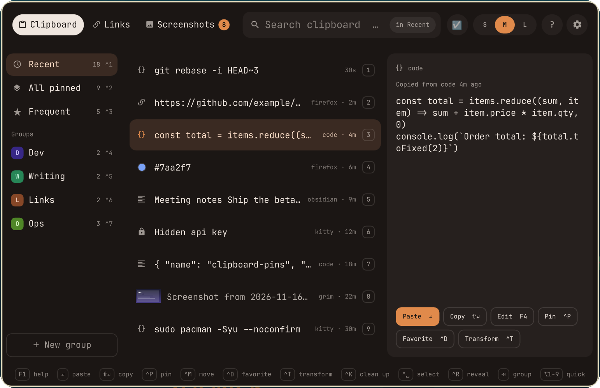

Pinly builds on Omarchy's own clipboard plugin: that plugin keeps recording what you copy, and Pinly reads it,
adds a long archive on top, and gives you pins, groups and the tools below.

## Install

```bash
omarchy plugin add https://github.com/moeymakes/omarchy-pinly.git --enable
omarchy-restart-shell
```

Leave Omarchy's built-in `omarchy.clipboard` plugin enabled (it is by default): it does the recording.

Bind a key in `~/.config/hypr/bindings.lua`. Pick one that suits you; a plain `CTRL + G` is a global bind and takes that
shortcut away from every app:

```lua
o.bind("SUPER + SHIFT + V", "Pinly", "omarchy-shell shell toggle io.github.moeymakes.pinly")
o.bind("SUPER + SHIFT + P", "Pin the last copy", "omarchy-shell io.github.moeymakes.pinly pinCurrent")
```

## Remove

```bash
omarchy plugin remove io.github.moeymakes.pinly
```

Remove the two bindings from `bindings.lua` too. Your pins and settings stay in `~/.local/state/omarchy/`
(`clipboard-pins*.json`, `clipboard-meta.json`, `clipboard-archive.json`, `clipboard-shots.json`) until you delete them.

## What it does

**Pins and groups.** `Ctrl+P` pins the selected entry into a group (Dev, Writing and Links to start; add your own with
`Ctrl+N`). Pins never expire and survive "clear history". Give a pin a label (`Ctrl+E`), tags (`Ctrl+Shift+E`) or a star
(`Ctrl+D`); filter by group with `Ctrl+1..9`.

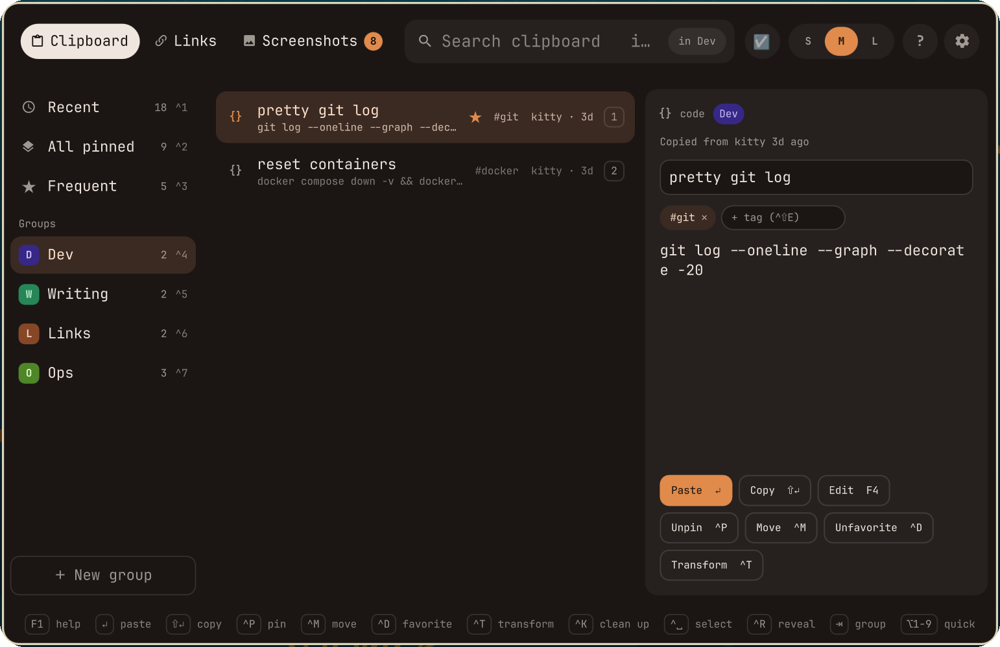

**Search.** Type to search; narrow it with `is:url`, `is:image`, `is:code`, `is:secret`, `is:pinned`, `is:fav`,
`app:kitty`, `in:dev` or `tag:work`.

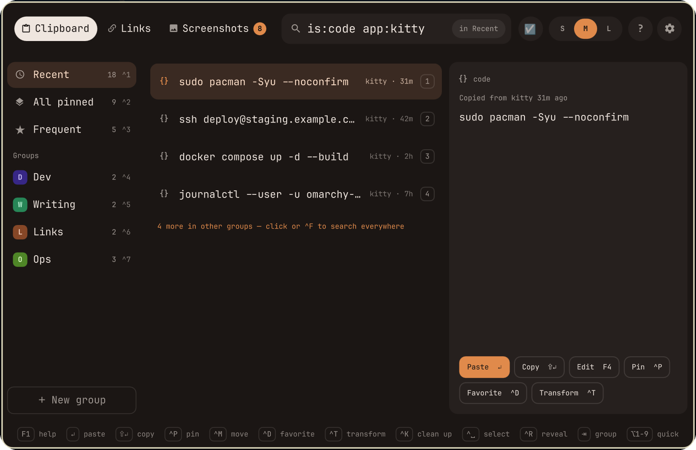

**Secrets stay hidden.** API keys, tokens, JWTs, private keys, database URLs and card numbers are masked in the list.
High-confidence ones are deleted after a time you choose (never, 1 minute, 10 minutes, 1 hour) unless pinned; guessed
passwords and tokens are masked but kept. `Ctrl+R` reveals them.

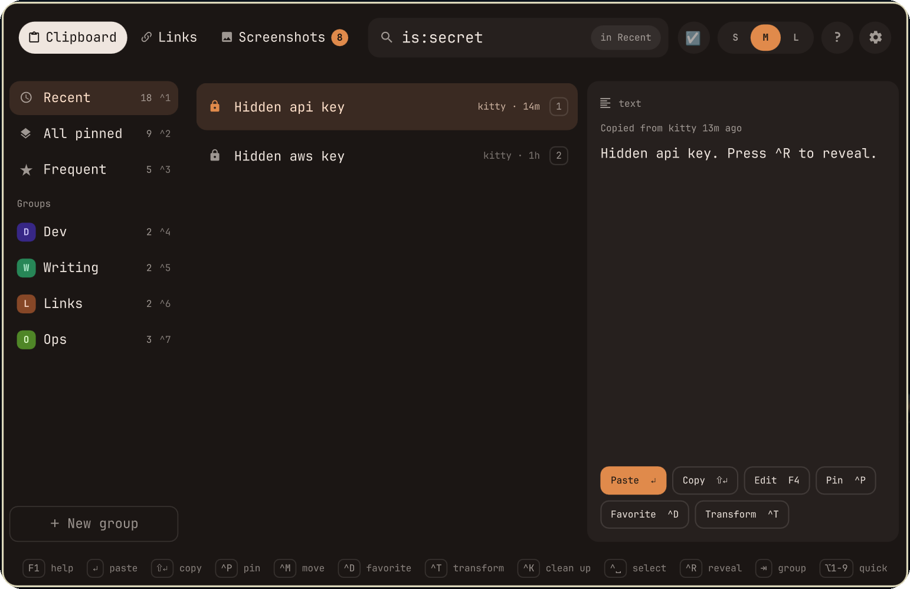

**Edit in place.** The preview text is always editable: click it (or press `F4`) and type. It saves by itself half a second after you stop, keeping the entry's place, time, label, group and star. Under it, a star button and one chip per group put the entry in your favorites or a group with one click (a click on its current group takes it out). `Ctrl+Enter` pastes your edit, `Esc` leaves the box.

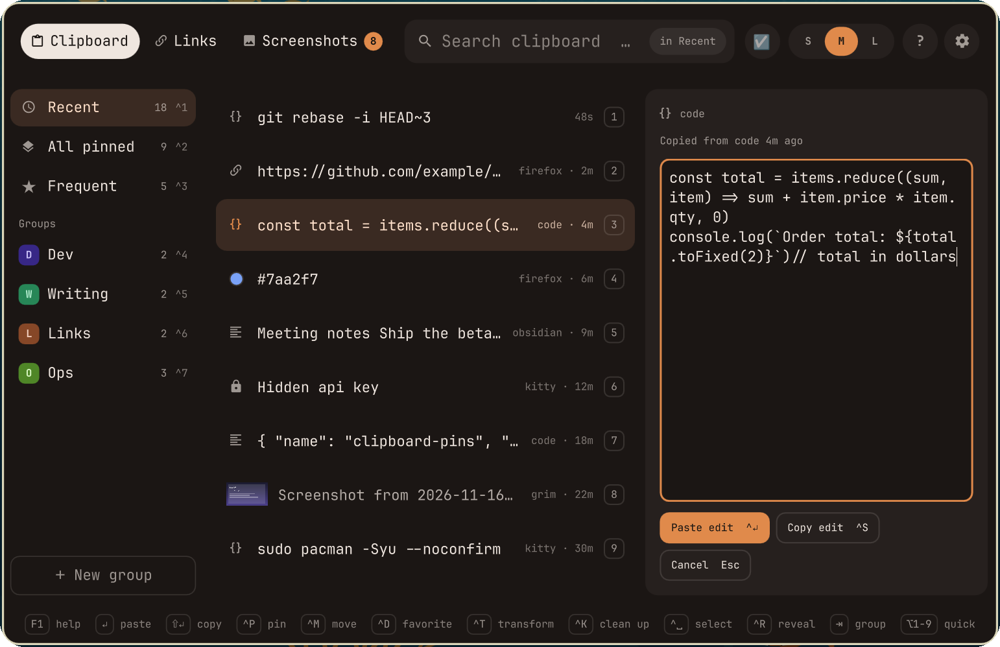

**Paste as.** `Ctrl+T` pastes the entry transformed: plain text, one line, upper or lower case, pretty or minified JSON,
Base64 or URL encoding. Pins can be templates using `{{date}}`, `{{time}}`, `{{weekday}}`, `{{clip}}`, `{{uuid}}` and
`{{ask:Name}}`.

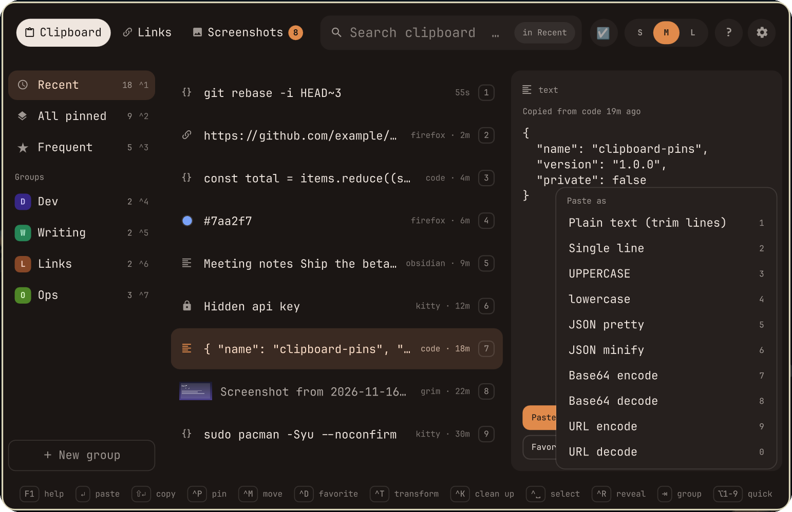

**Paste queue.** Tick several entries (`Ctrl+Space`, `Shift+Up/Down`, Shift+click) and paste them one after another with
Tab or new lines between (`Ctrl+Enter`, `Ctrl+Shift+Enter`). Tick a whole search with `Ctrl+A`; `Ctrl+K` offers ready-made
clean-up sets (unused for 30 days, secrets, very large).

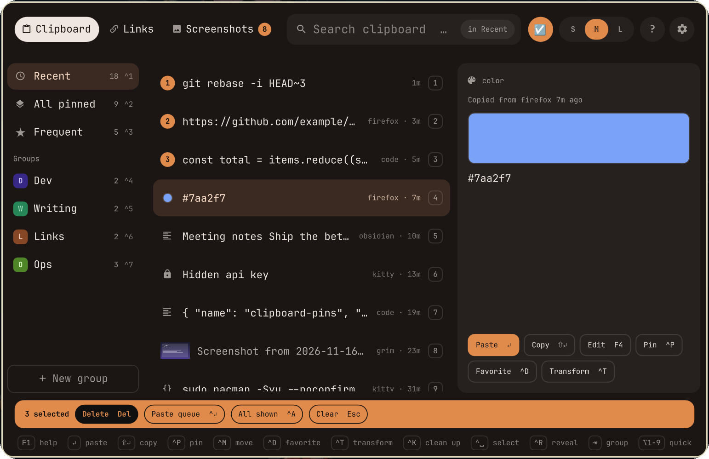

**Frequent view.** The entries you paste most, ranked by use.

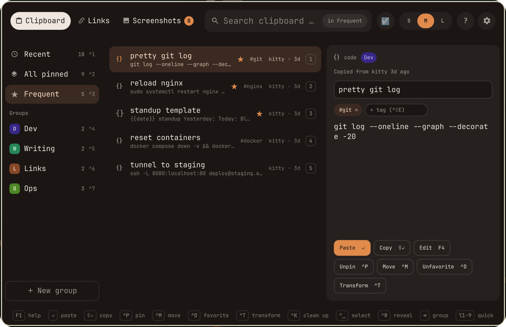

**Screenshots tab.** `Ctrl+Right` opens a third tab that turns `~/Pictures` into an inbox: new shots appear with a
thumbnail, you sort them into categories with `1-9`, star them, trash them (restorable), or step through them in triage
mode (`T`). Text inside images is searchable (needs `tesseract`). Files are never moved or deleted permanently.

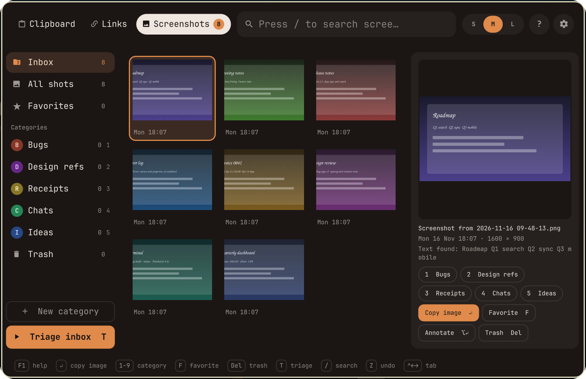

**Also.** A long searchable archive (default 2,000 entries, up to 10,000); private mode (`Ctrl+Shift+P`) and a list of
apps whose copies are never kept; four paste methods; export and import of pins; optional folder or SSH sync between
machines; text from images (`Ctrl+O`); three window sizes; themes (one follows your Omarchy theme), accent colour, density,
corners and font in the settings drawer (`Ctrl+,`).

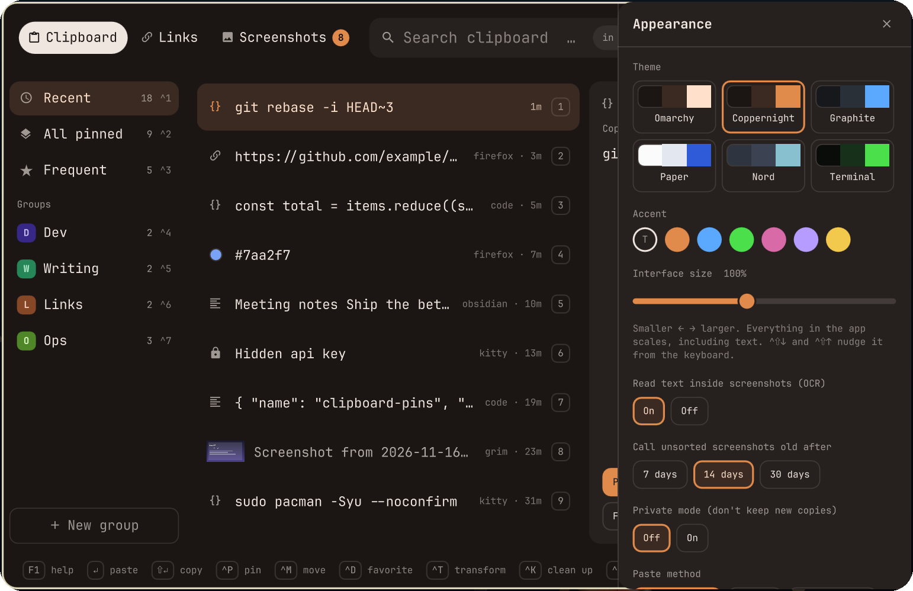

Press `F1` for every shortcut and a short guide.

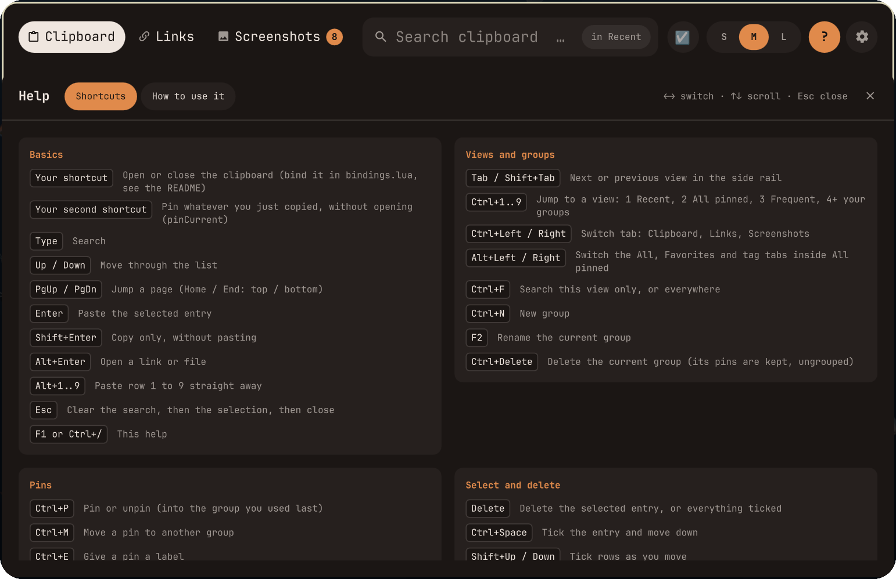

## Keys

| Key | Action |
|---|---|
| Enter / Shift+Enter | paste / copy only |
| Alt+1..9 | paste row 1 to 9 |
| Ctrl+P / Ctrl+D / Ctrl+M | pin / star / move to a group |
| Ctrl+E / Ctrl+Shift+E | label / tags |
| Click the text, or F4 | edit it; saves automatically |
| Ctrl+T | paste as (transform) |
| Ctrl+Space, Ctrl+A, Ctrl+K | tick / tick all matches / clean up |
| Delete, Ctrl+Z | delete selection, undo |
| Tab, Ctrl+1..9, Ctrl+N, F2 | next group, jump to group, new group, rename group |
| Ctrl+Left / Right | switch tab: Clipboard, Links, Screenshots |
| Ctrl+R | reveal hidden secrets |
| Ctrl+O | text from the selected image |
| Ctrl+Shift+P | private mode |
| Ctrl+= / Ctrl+- | window size |
| Ctrl+, | settings |
| F1 | help |

Commands you can bind or script: `omarchy-shell io.github.moeymakes.pinly pinCurrent`, `togglePrivate`, `openGroup <name>`,
`exportBackup`, `sync`.

## Requirements

Omarchy 4 (tested on 4.5.0) with its default `omarchy.clipboard` plugin. Pinly uses `wl-clipboard`, `wtype`, `jq`,
`hyprctl`, and for the Screenshots tab `inotify-tools`, `imagemagick`, `libvips`, `glib2` and `tesseract`; all of these
are part of Omarchy's default package set. Annotating a screenshot opens `omasnap` (or `tensaku-edit` on older Omarchy).
Sync uses `ssh` and `notify-send` is used for private-mode messages.

## Privacy and security

- Everything stays on your machine. Pinly makes no network connections of its own; SSH sync only talks to the host you
  name, and folder sync only writes to the folder you choose.
- State files are kept at mode 600 and backups at 700. A file that cannot be read is copied aside and never overwritten.
- Pinly shows a snapshot of your history, so what the stock plugin recorded before masking is still on disk in its own
  history file until it is deleted there; deleting from Pinly removes the entry from both.
- **Sync folder and SSH sync are plaintext.** Any pin you sync, including a secret you pinned, sits unencrypted in that
  folder or on the other machine. Anyone who can write to the folder can add or remove your pins. Do not sync a folder
  you do not control.
- Text pasted through transforms, templates, the editor and the paste queue is handed to a helper script as a
  command-line argument, which other local users can read from `/proc` on systems that do not hide it. Entries from the
  list itself are pasted from files and are not affected.
- Very large copies (several MB) slow the list down while they sit in history.
- Pinly is written against Omarchy's shell modules and may need an update when they change. Plugins run unsandboxed, so
  read the source before enabling any plugin, this one included.

An independent review found and fixed one data-loss bug in the SSH sync and several smaller issues before release; the
tests cover the merge and secret-detection logic.

## Tests

```bash
node --test tests/*.test.mjs
```

## Credits and license

MIT, see `LICENSE`. Parts derive from Omarchy's clipboard plugin (also MIT); see `NOTICE.md`.
